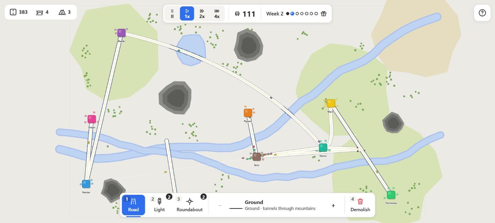
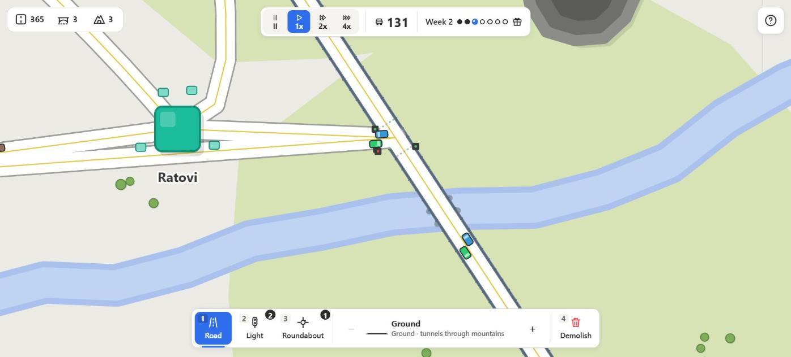
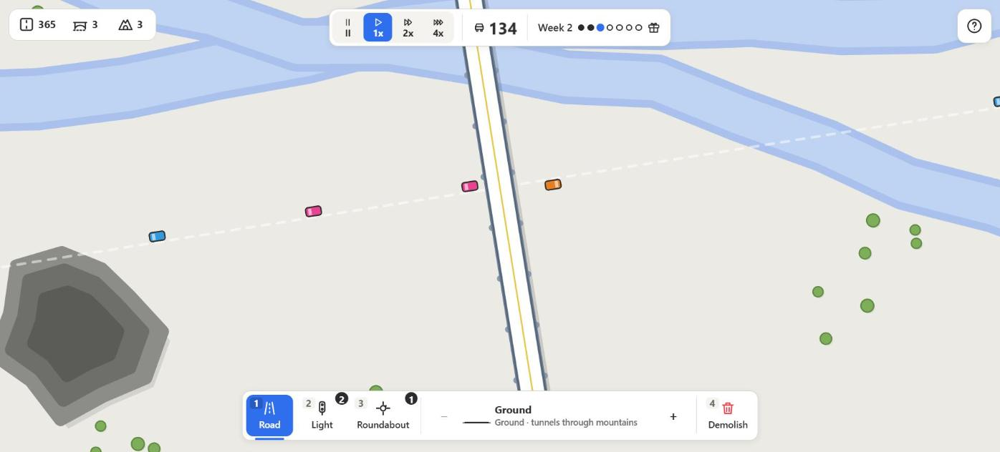
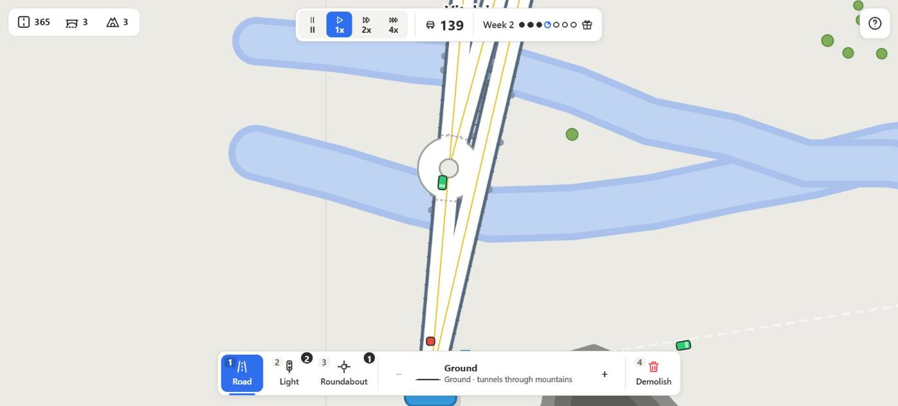
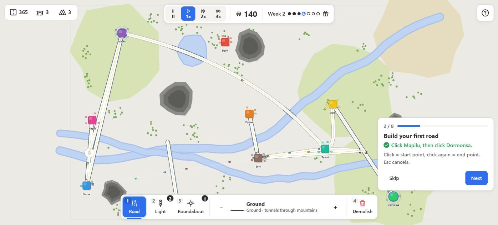
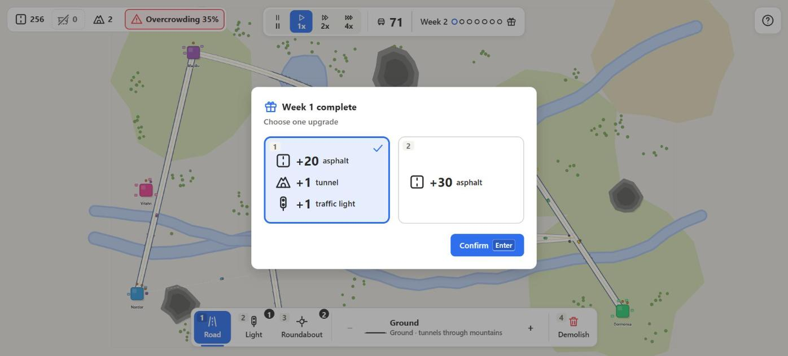
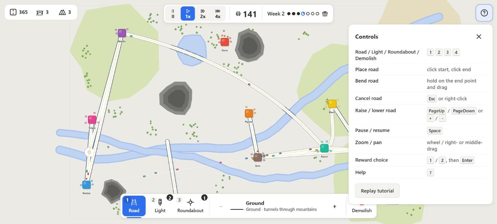

<h1 align="center">TrafficMania</h1>

<p align="center">
  A minimalist 2D traffic-management game for the browser. Connect growing cities with curved roads, viaducts and tunnels, keep the cars flowing and survive the weekly rush.
</p>

<p align="center">
  
</p>

<p align="center">
  <a href="#getting-started">Getting started</a> ·
  <a href="#how-to-play">How to play</a> ·
  <a href="#features">Features</a> ·
  <a href="#architecture">Architecture</a> ·
  <a href="#development">Development</a>
</p>

---

## Overview

TrafficMania is a *Mini Motorways*-style puzzle about road design. Cities appear on a procedurally generated map of rivers, lakes and mountains. Each city spawns cars that want to reach another city, and every car is painted with the colour of its destination. Your job is to draw a road network that gets them there before any city becomes **overcrowded**.

Cars are simulated individually: they drive on the right-hand lane, keep a safe distance from the vehicle in front, queue at intersections and pick the fastest route through the network, taking current congestion into account. Bad road design produces real traffic jams.

Built with **TypeScript**, **Vite** and the **HTML5 Canvas 2D** API. No game engine, no runtime dependencies.

## Getting started

```bash
git clone https://github.com/William19D/TrafficMania.git
cd TrafficMania
npm install
npm run dev        # http://localhost:5173
```

```bash
npm run build      # type-checks and bundles into dist/
npm run preview    # serves the production build
```

Requires Node.js 18 or newer.

## How to play

| Action | Mouse | Keyboard |
|---|---|---|
| Select tool | Click a button in the dock | `1` Road · `2` Traffic light · `3` Roundabout · `4` Demolish |
| Place a road | Click the start point, click the end point | `Esc` cancels |
| Bend a road | Hold the button on the end point and drag | |
| Change road elevation | `−` / `+` in the dock | `PageDown` / `PageUp` |
| Pause, 1x, 2x, 4x | Clock buttons | `Space` toggles pause |
| Zoom and pan | Mouse wheel · right or middle drag | |
| Pick a weekly reward | Click a card | `1` / `2`, then `Enter` |
| Controls and tutorial | `?` button | `?` |

An interactive, eight-step tutorial starts on the first launch and can be replayed at any time from the help panel.

## Features

<table>
  <tr>
    <td width="50%" valign="top">
      
      <p><b>Real car-following simulation.</b> Every car brakes for the vehicle ahead, queues at junctions in arrival order and never overlaps. Traffic lights alternate phases between the two axes of an intersection.</p>
    </td>
    <td width="50%" valign="top">
      
      <p><b>Elevation from 0 to 10.</b> Raise a road to build a viaduct that crosses water and lower roads without creating an intersection. Level 6 and above clears mountains; ground roads dig tunnels instead.</p>
    </td>
  </tr>
  <tr>
    <td width="50%" valign="top">
      
      <p><b>Roundabouts and bridges.</b> A roundabout lets up to three cars through at once. Crossing a river or a lake at ground level builds a bridge with railings and pillars.</p>
    </td>
    <td width="50%" valign="top">
      
      <p><b>Guided tutorial.</b> Eight task-driven steps with pulsing targets on the map and highlighted controls. Each step waits for the real action before it lets you continue.</p>
    </td>
  </tr>
  <tr>
    <td width="50%" valign="top">
      
      <p><b>Weekly rewards.</b> Each in-game week ends with a choice between two inventory upgrades: asphalt tiles, bridges, tunnels, traffic lights or roundabouts.</p>
    </td>
    <td width="50%" valign="top">
      
      <p><b>A HUD you can read at a glance.</b> Icon dock with stock badges, resource chips, week progress, tooltips with shortcuts, on-map hover feedback and keyboard access to everything.</p>
    </td>
  </tr>
</table>

### More under the hood

- **Pen-tool roads.** Click two points and the road curves on its own to join existing roads smoothly, using the tangent of the road it connects to. Drag the end point to bend it by hand.
- **A\* routing with congestion.** Cars compute their route when they enter each road, weighting every segment by its length and by how many cars are already on it, so traffic spreads across alternatives.
- **Procedural maps.** Rivers, lakes, mountains, sand and grass patches, tree clusters and city names are generated for every game.
- **Overcrowding pressure.** Cars waiting without a route pile up around their city. A red ring fills while the city is overcrowded; if it completes, the game is over.
- **Demolish with refunds.** Removing a road returns its asphalt, bridges and tunnels to your inventory.

## Architecture

```
src/
├── core/        Game state, building rules, inventory, rewards, game loop
├── world/       Terrain generation and city spawning
├── network/     Road graph (nodes, two-lane edges, splitting, controls) and A* pathfinding
├── entities/    City demand and car physics
├── rendering/   Canvas 2D renderer with camera, layers per elevation and preview
├── ui/          HUD, tutorial, input state machine and inline SVG icons
└── util/        Geometry and Bézier helpers
```

- The simulation runs in fixed sub-steps of 1/60 s scaled by the selected speed, so 4x stays stable.
- Roads are straight edges between nodes; curves are sampled into one-tile chords, so the car physics never deals with Bézier math.
- Elevated roads are drawn in ascending layers, with cars drawn right after the roads of their own level.
- The HUD only writes to the DOM when a value changes.

A written design spec for the interface lives in [`docs/hud-design.md`](docs/hud-design.md).

## Development

```bash
npx tsc --noEmit     # type-check only
npm run build        # type-check + production bundle
```

The project is strict TypeScript with explicit `.ts` import extensions, no linter configuration and no test framework. `window.game`, `window.renderer`, `window.tutorial` and `window.hud` are exposed in the browser console for debugging and scripted testing.

## License

MIT
