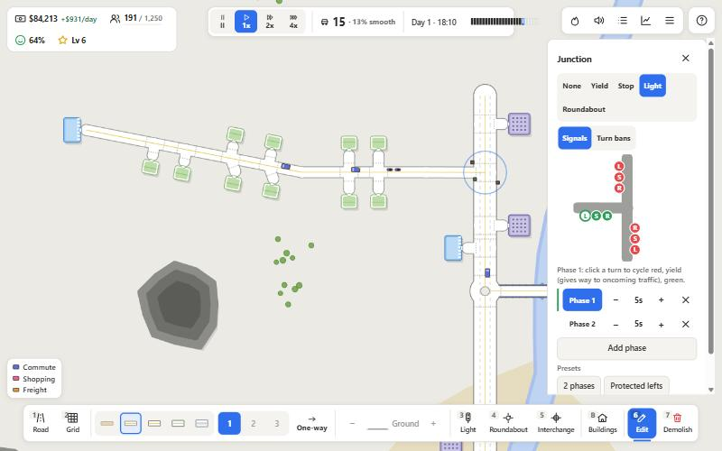
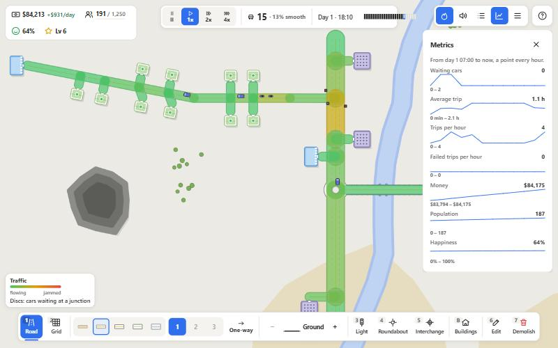

<h1 align="center">TrafficMania</h1>

<p align="center">
  A minimalist 2D traffic-management city game for the browser. Homes, shops, offices and factories send their people and goods out every day: design the road network, find the bottleneck, fix it, and grow the city.
</p>

<p align="center">
  
</p>

<p align="center">
  <a href="#getting-started">Getting started</a> ·
  <a href="#how-to-play">How to play</a> ·
  <a href="#features">Features</a> ·
  <a href="#architecture">Architecture</a> ·
  <a href="#development">Development</a>
</p>

---

## Overview

TrafficMania is a traffic-management game in the spirit of *Traffic Architect*, drawn in a flat top-down style like *Trafficity*. A seeded, procedurally generated map holds a small starter town. Its buildings make real trips: commuters drive from home to work and back, residents go shopping, and factories send trucks of goods to the shops. Every car is simulated on its own. It picks a lane for its next turn, queues at junctions and routes around traffic.

You build and fix the network. You choose the road tier, the lanes and one-way streets, and the junction control: yield, stop, traffic lights with editable phases, protected lefts, lane connections you drag on the map, and roundabouts. You can also raise viaducts, dig tunnels and build interchanges. Smooth trips make residents happy, and happy homes fill up and pay more taxes. Each population milestone levels the city up, hands you a new batch of buildings to place and unlocks new tools.

Built with **TypeScript**, **Vite** and the **HTML5 Canvas 2D** API. There is no game engine and there are no runtime dependencies.

## Getting started

```bash
git clone https://github.com/William19D/TrafficMania.git
cd TrafficMania
npm install
npm run dev        # http://localhost:5173
```

```bash
npm run build      # type-checks and bundles into dist/
npm run preview    # serves the production build
```

Requires Node.js 18 or newer.

## How to play

1. **Start a game** from the main menu.
   - **Career**: a budget and goals. Bankruptcy or collapsing happiness ends the run.
   - **Creative**: unlimited money, every tool unlocked, and no way to lose.
   - Pick the difficulty, the biome (temperate, desert, alpine, archipelago) and the map size. The seed replays the same map.
2. **Connect the buildings.**
   - Draw roads from door to door.
   - A building next to a road gets a free driveway.
3. **Watch the day.**
   - Commuters leave home between 6:00 and 10:00 and come back after a 9-hour shift.
   - Shoppers go out from mid-morning to the evening.
   - Factories with workers send trucks of goods to the shops.
4. **Find the bottleneck.**
   - The heat map shows the jammed roads and the junctions where cars wait.
   - Trip reports say how each trip went.
   - The metrics chart the whole run.
5. **Fix it.** You can:
   - upgrade the tier or add lanes;
   - make a street one-way;
   - time the lights or protect the lefts;
   - ban a turn;
   - build a roundabout, an overpass or an interchange.
6. **Grow.**
   - Each level brings a batch of homes, shops, offices and factories to place.
   - Keep homes away from factory smog and loud roads.
7. **Mind the money.** Roads, bridges, tunnels and controls cost money to build and upkeep to keep. Taxes and business income pay for them.

| Action | Mouse | Keyboard |
|---|---|---|
| Tools, in dock order | Click a dock button | `1` Road · `2` Grid · `3` Light · `4` Roundabout · `5` Interchange · `6` Edit · `7` Demolish |
| Place buildings | **Buildings** in the dock, or a card in the tray | `B`, `R` turns a free-standing one |
| Place / bend a road | Click the start, click the end; hold the end and drag to bend | `Esc` or right-click cancels |
| Road type | Tier, lanes 1 / 2 / 3 and **One-way** in the dock | applies to new roads, or to the road selected with Edit |
| Elevation | `−` / `+` in the dock | `PageDown` / `PageUp` |
| Edit | Click a car (follow), a building (details), a junction (control, phases, drag lane connections) or a road (retype, drag to bend) | `6` |
| Heat map / noise and pollution | Overlay buttons, top right | `C` cycles |
| Trip reports / metrics | Panel buttons, top right | `T` / `M` |
| Pause, 1x, 2x, 4x | Speed buttons | `Space` toggles pause |
| Menu: save, load, quit | Menu button | `Esc` when nothing else is open |
| Zoom and pan | Wheel · right or middle drag | |
| Controls and tutorial | `?` button | `?` |

A nine-step interactive tutorial starts with your first game, and you can replay it from the controls panel.

## Features

<table>
  <tr>
    <td width="50%" valign="top">
      
      <p><b>Junction control.</b> Every junction can have no control, yield signs (the main road goes first), an all-way stop, a traffic light or a roundabout. Lights run phases you can edit, with protected or permissive lefts. You can ban any turn, and cars reroute around it.</p>
    </td>
    <td width="50%" valign="top">
      
      <p><b>Analysis tools.</b> A congestion heat map, a noise and pollution overlay, a camera that follows any car, building cards with their happiness parts, trip reports in the residents' own words, and charts over the whole run.</p>
    </td>
  </tr>
  <tr>
    <td width="50%" valign="top">
      
      <p><b>Guided tutorial.</b> Nine task-driven steps: connect the homes, watch a commute, place a building, open the shop, add a light and time it, read the heat map, then money and levels. Each step waits for the real action, with targets on the map and highlighted controls.</p>
    </td>
    <td width="50%" valign="top">
      <p><b>A city that answers back.</b> Homes rate their access to jobs and shops, how smooth their trips are, and the factory smog and road noise next door. Happy homes fill up and pay more taxes. Unhappy ones empty out. Factories need workers before they ship goods, and shops need customers and deliveries.</p>
      <p><b>Levels and batches.</b> Population milestones bring a grant, a batch of buildings to place, and unlocks: road tiers, one-way streets, roundabouts, viaducts and ramps, the light-phase editor, tunnels, the Grid tool and interchanges. Level 10 completes the city, and endless mode keeps going after it.</p>
    </td>
  </tr>
</table>

### More under the hood

- **Road hierarchy.** There are five tiers: dirt, street, avenue, boulevard and highway. Each has its own speed limit, lanes, price, upkeep and noise. Highways give no building access. Routing weighs travel time and live congestion, so a fast road draws traffic.
- **Pen-tool roads.** Click two points and the road curves on its own to join the roads it meets. Drag the end point to bend it by hand.
- **Elevation 0 to 10.** Viaducts cross water and other roads without a junction, and level 6 and above clears mountains. On the ground, a road over water builds a bridge and a road through a mountain digs a tunnel. A road that starts or ends on another level becomes a ramp that climbs one level per tile.
- **Grid and interchanges.** The Grid tool lays a whole street grid in three clicks. The Interchange tool turns a junction into a diamond, a cloverleaf or a trumpet, with a price preview.
- **Car-by-car simulation.** Cars choose their lane by their next turn and change lanes mid-road. They keep a safe gap, brake for corners and slower tiers, and never block the box. A deadlock breaker reroutes stuck cars. Cars, trucks, buses, motorbikes and ambulances drive with brake lights and turn signals.
- **Money.** Roads are priced per tile by tier, lanes and terrain. Demolishing refunds everything on the day you built it and half after that. Taxes scale with population and happiness, and every worker, shopper and delivery that arrives pays business income.
- **Seeded maps.** Rivers, lakes, mountains, vegetation and the starter town come from the seed, in four biomes and three difficulty levels.
- **Save and load.** The game autosaves every in-game midnight and has three manual slots, all in local storage.

## Architecture

```
src/
├── core/        Game state and rules (economy, trips, happiness, levels), config tables, metrics, save/load,
│                interchange templates, the game loop
├── world/       Seeded terrain generation and the starter town
├── network/     Road graph (nodes, laned edges, splitting, controls), junction plans, A* routing
├── entities/    Buildings, trips and car physics
├── rendering/   Canvas 2D renderer: camera, layers per elevation, overlays, previews
├── ui/          HUD, main and pause menus, tutorial, input state machine, inline SVG icons
└── util/        Seeded RNG, geometry and Bézier helpers
```

- Every gameplay number lives in `src/core/config.ts` (`TIERS`, `ZONES`, `LEVELS`, `UNLOCKS`, `DIFFICULTY`, `BIOMES`, `TUNING`).
- The simulation runs in fixed 1/60 s sub-steps scaled by the game speed, so 4x stays stable. All randomness goes through the seeded stream in `src/util/rng.ts`.
- Roads are straight edges between nodes. Curves are sampled into one-tile chords, so the car physics never deals with Bézier math.
- The HUD is plain DOM and only writes when a value changes.

Design specs: [`docs/design/gameplay.md`](docs/design/gameplay.md) (the game model) and [`docs/hud-design.md`](docs/hud-design.md) (the interface).

## Development

```bash
npx tsc --noEmit     # type-check only
npm run build        # type-check + production bundle
npm run simcheck     # headless deterministic simulation check
```

The project is strict TypeScript with explicit `.ts` import extensions. It has no linter configuration and no test framework.

`scripts/simcheck.ts` builds fixed networks and checks the car invariants (sorted lanes, no overlaps, clean junction occupants) and the game rules: prices, levels, happiness, fail conditions, junction plans, interchanges, metrics, save round-trips and the tutorial's tasks.

URL parameters (`?seed=&biome=&difficulty=&size=&mode=`) skip the menu and start that game. `window.game`, `window.renderer`, `window.tutorial` and `window.hud` are exposed in the browser console for debugging.

## License

MIT
